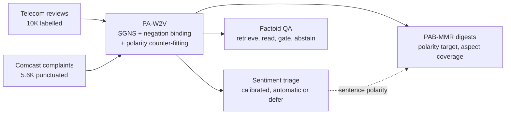

# TeleLens: Telecom Feedback Intelligence

**One evaluated NLP system covering four case studies: Word2Vec, Sentiment Classification, Text Summarization and Factoid Question Answering.**

[](docs/case_study_report.pdf)


**Author:** Bharat Chandra Bodapati (Student ID 2023005380)

**Submitted to:** Radha Karampudi, Assistant Professor, Department of Computer Science and Systems Engineering, GITAM School of Computer Science and Engineering, Hyderabad

Telecom teams need to find unhappy customers, understand what customers say in aggregate, and look up facts in old complaints. TeleLens does all three from real public reviews. It also measures its failures and declines to decide when its evidence is weak.

**[Read the full report (PDF)](docs/case_study_report.pdf)**

## Results at a glance

| Case study | Original contribution | Baseline | TeleLens |
|---|---|---|---|
| **Word2Vec** | PA-W2V: negation binding and polarity counter-fitting | Held-out antonym cosine 0.683 | **0.373** |
| | | Neighbour polarity purity 0.773 | **0.839** |
| **Sentiment** | Calibrated triage with cross-fitted deferral | TF-IDF macro-F1 0.897 | **DistilBERT 0.916** |
| | | 5% error target, no control | **4.93% achieved at 91% coverage** |
| **Summarization** | PAB-MMR: polarity and aspect balance | MMR polarity gap 0.059 | **0.019** |
| | | MMR aspect recall 0.680 | **0.850** |
| | Punctuation recovery for unpunctuated text | Fixed windows boundary F1 0.299 | **0.828** |
| **Factoid QA** | Answer-type gating and abstention | Always answer: accuracy 0.477 | **0.602** |
| | | Answered exact match 0.618 | **0.755** |
| | | Unanswerable rejected 0% | **80%** |
| | | Answerability AUROC | **0.847** |
| | | Exact match when the right complaint is found | **0.894** |

### What did not improve

These results are reported on purpose:

- **ROUGE is a statistical tie.** PAB-MMR and MMR differ by +0.001 ROUGE-2 on FewSum (p = 0.41, 20 products).
- **Word2Vec hurts fact retrieval.** BM25 has MRR 0.699, against 0.39 to 0.43 for equal-weight fusion with embeddings.
- **TF-IDF + PA-W2V ties TF-IDF** for sentiment (p = 0.60).
- **SimLex-999 is unchanged**, and mean pooling hides most of the word-level gain at sentence level.
- **The telecom digest advantage is on metrics PAB-MMR optimises.** No reader study has been run.
- **The factoid gold set has one annotator**, and the test set was not fully blind. See Section 10 of the report.

## Architecture



## Notebooks

| Notebook | Case study | Recorded results |
|---|---|---|
| [01_word2vec](notebooks/01_word2vec.ipynb) | SGNS from scratch, gensim baselines, PA-W2V | [results/word2vec](results/word2vec) |
| [02_sentiment_classification](notebooks/02_sentiment_classification.ipynb) | Nine models, calibration, selective triage, robustness | [results/sentiment](results/sentiment) |
| [03_text_summarization](notebooks/03_text_summarization.ipynb) | PAB-MMR, TextRank, BART, punctuation recovery | [results/summarization](results/summarization) |
| [04_factoid_question_answering](notebooks/04_factoid_question_answering.ipynb) | BM25, hybrid retrieval, readers, gating, abstention | [results/qa](results/qa) |
| [05_integrated_system](notebooks/05_integrated_system.ipynb) | All four together, plus unit tests | [results/integrated](results/integrated) |

Each notebook ends with a recorded results section, so you can read the outcomes without running anything.

## Usage

```python
from telelens.data import load_comcast, load_telecom
from telelens.pipeline import TeleLens

system = TeleLens(load_telecom(10000), load_comcast(), "deepset/roberta-base-squad2", device="cuda")

system.triage("my broadband keeps disconnecting and customer service has not fixed it")
# prediction: Bad, decision: automatic, plus the most similar past reviews

system.digest(list_of_reviews)
# a short summary that keeps the positive and negative balance of the reviews

system.ask("Which insurance company refused to pay the full electrician estimate after faulty cable wiring?")
# answer: Liberty Mutual, with the source complaint as evidence

system.ask("How much does Comcast charge for 5G home internet in Seattle?")
# status: abstained, because the corpus does not contain this fact
```

## Executed runs on Kaggle

Every run is public, with its code, cell outputs and log. Each one cloned this repository from GitHub.

| Case study | Kaggle notebook |
|---|---|
| Word2Vec | [telelens-01-word2vec](https://www.kaggle.com/code/bharatchandra1234/telelens-01-word2vec) |
| Sentiment Classification | [telelens-02-sentiment](https://www.kaggle.com/code/bharatchandra1234/telelens-02-sentiment) |
| Text Summarization | [telelens-03-summarization](https://www.kaggle.com/code/bharatchandra1234/telelens-03-summarization) |
| Factoid QA | [telelens-04-factoid-qa](https://www.kaggle.com/code/bharatchandra1234/telelens-04-factoid-qa) |
| Integrated system | [telelens-05-integrated](https://www.kaggle.com/code/bharatchandra1234/telelens-05-integrated) |

## Reproduce the results

The experiments need a GPU, so they are designed to run on Kaggle.

1. Open a notebook from [`notebooks/`](notebooks) on Kaggle.
2. Turn on a GPU and internet access.
3. Attach the [Comcast complaints dataset](https://www.kaggle.com/datasets/amirizzudin4/comcast-consumer-complaints).
4. Run all cells. The first cell clones this repository and downloads the public data.

The full set takes roughly one to two hours on a T4 GPU. Seeds are fixed at 42. A second full run reproduced the main results. Only the multi-threaded gensim baselines moved noticeably (FastText sentiment macro-F1 went from 0.863 to 0.857), and DistilBERT's 5% deferral count moved from 892 to 895 reviews.

To use your own Kaggle account from a local machine, set `KAGGLE_USERNAME` and `KAGGLE_API_TOKEN`, change `USER` in [`tools/kaggle_sync.py`](tools/kaggle_sync.py), and run:

```bash
pip install -r requirements.txt
python tools/kaggle_sync.py code -m "update"   # upload code as a private dataset
python tools/kaggle_sync.py push 01            # run a notebook on Kaggle
python tools/kaggle_sync.py pull 01            # download its outputs
python tools/collect_results.py                # copy outputs into results/
python tools/extra_metrics.py                  # calculate extra sentiment metrics
python tools/make_code_listings.py             # extract code listings for the report
python tools/make_tables.py                    # rebuild the report tables
```

## Repository layout

```text
src/telelens/       Core library
  text.py           Tokenizing, negation binding, segmentation
  embeddings.py     SGNS from scratch, polarity counter-fitting
  sentiment.py      Classifiers, DistilBERT fine-tuning, calibration
  summarize.py      PAB-MMR and baselines
  punctuate.py      Punctuation restoration for sentence recovery
  qa.py             BM25, hybrid retrieval, reader, answer gate
  metrics.py        Statistical tests, calibration, QA metrics
  pipeline.py       TeleLens: triage, digest, ask
notebooks/          One notebook per case study, plus the integrated system
results/            Every recorded table, prediction file and figure
data/gold/          Factoid QA gold set (132 questions)
docs/               Report PDF and LaTeX source
tests/              Unit tests
tools/              Notebook builder, Kaggle sync, report table generator
```

## Data sources

| Dataset | Use | Source |
|---|---|---|
| WEDataset (10K and 1K mixed reviews) | Word2Vec, sentiment, digests | [HeshamAsem/WEDataset](https://github.com/HeshamAsem/WEDataset) |
| Comcast ConsumerAffairs complaints | QA corpus, cross-domain test | [Kaggle](https://www.kaggle.com/datasets/amirizzudin4/comcast-consumer-complaints) |
| FewSum Amazon gold summaries | Summarization references | [abrazinskas/FewSum](https://github.com/abrazinskas/FewSum) |
| SQuAD v1.1 dev | Reader benchmark | [SQuAD](https://rajpurkar.github.io/SQuAD-explorer/) |
| SimLex-999 | Similarity benchmark | [SimLex-999](https://fh295.github.io/simlex.html) |

Raw datasets are downloaded at run time and are not stored here. Their terms belong to their owners. The WEDataset repository declares no licence.

## Scope

TeleLens is a research prototype for assisting human analysts. It has not been tested in a live support operation, so it makes no claim about reduced waiting time or cost. Its datasets contain no demographic attributes, so it has not been assessed for fairness.
